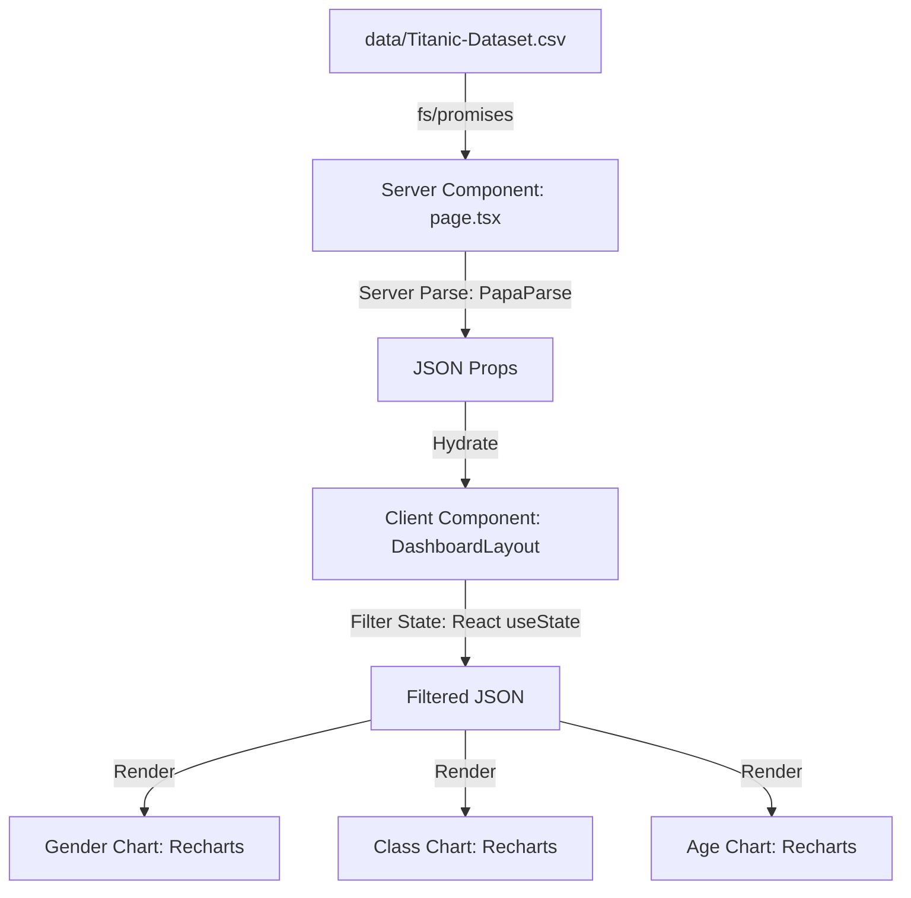

# Technical Architecture: Next.js Titanic Visualization

This document defines the selected technical architecture and directory layout for the Titanic Survival Data Visualization Web Application.

---

## 1. Core Architecture

The web application is structured to leverage **React Server Components (RSC)** for fast data loading and local file access, combined with client-side interactive rendering for charts and filters.



### Server-Side Data Pipeline
* **Storage**: The Titanic dataset resides locally at [Titanic-Dataset.csv](../../data/Titanic-Dataset.csv).
* **Loading**: We will use Node.js `fs/promises` in server-side entry points to read the file directly from the filesystem, avoiding unnecessary REST/network overhead.
* **Parsing**: `papaparse` will be executed on the server to translate the CSV content into a clean, typed JSON array of passenger records.

### Client-Side Interactive Filtering
* **State Management**: A parent controller component will hold the filtering criteria (Sex, Ticket Class, Age Range, and Fare Range).
* **Data Flow**: The raw passenger JSON array passed from the server is filtered reactively on the client using memoized selectors (`useMemo`) to ensure 60fps interaction speed.

---

## 2. Directory Structure

```text
design_thinking/
├── .agents/
│   └── AGENTS.md                  # Project rules & guidelines
├── docs/
│   ├── constitution/
│   │   ├── mission.md             # Project goals & hypotheses
│   │   ├── tech-stack.md          # Tech stack details
│   │   ├── architecture.md        # [THIS FILE] Core architecture spec
│   │   └── roadmap.md             # Project roadmap (Now/Next/Later)
├── data/
│   └── Titanic-Dataset.csv        # Source CSV file
└── web-app/                       # Next.js Application Root
    ├── public/                    # Static assets
    ├── src/
    │   ├── app/
    │   │   ├── layout.tsx         # HTML shell, fonts, and global styling
    │   │   └── page.tsx           # Server Component: reads & parses dataset
    │   ├── components/
    │   │   ├── Dashboard.tsx      # Main layout / state coordinator
    │   │   ├── FilterPanel.tsx    # Dropdowns, inputs, and sliders
    │   │   ├── SurvivalChart.tsx  # General Recharts bar / area wrapper
    │   │   └── MetricCard.tsx     # KPI tiles (Survival Rate, Counts)
    │   ├── styles/
    │   │   ├── globals.css        # Global CSS resets, theme tokens
    │   │   └── dashboard.module.css # Scoped grid & glassmorphism classes
    │   └── types/
    │       └── titanic.ts         # TypeScript interface for Passenger data
    ├── package.json
    ├── tsconfig.json
    └── next.config.js
```
